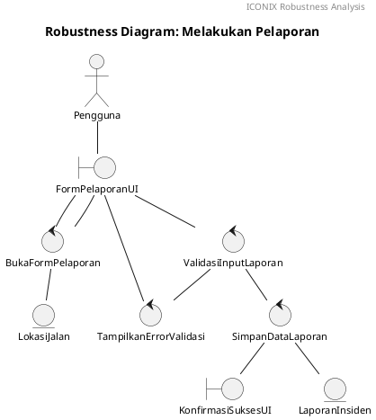

# ICONIX Process Guide (Agile Modeling with UML)

The ICONIX Process is a minimalist, use case driven object modeling approach developed by Doug Rosenberg & Matt Stephens (*Agile Development with ICONIX Process*). It bridges the gap between requirements and code via 4 iterative phases and 3 major milestones.

## 1. The 4 Phases

### Phase 1: Requirements
- **Functional Requirements:** Declarative "The system shall..." statements.
- **Domain Modeling (The "Cast of Characters"):**
  - Identify key problem-domain concepts and real-world business entities (classes without methods or database types).
  - *Golden Rule:* **Domain Model != ER Diagram**. No primary keys, foreign keys, or SQL data types (`INT`, `VARCHAR`). Only business vocabulary and relationships (`is-a` generalization, `has-a` aggregation).
- **GUI Storyboarding:** Mockups/wireframes (Figma) to anchor concrete user interactions.
- **First-Draft Use Cases:** Describe interaction between actor and system following:
  - *Two-Paragraph Rule:* Paragraph 1 describes the Basic Course (happy path); Paragraph 2 describes Alternate Courses (errors/exceptions).
  - *Active Voice & Event/Response:* Alternate explicitly between actor action and system response.
  - *Reference Domain Classes by Name:* Nouns in use case text must match domain class names verbatim.
- **Milestone 1: Requirements Review:** Verify that the "Golden Triangle" (Domain Model <-> GUI Storyboard <-> Use Case Text) is 100% consistent.

### Phase 2: Analysis / Preliminary Design
- **Robustness Analysis (BCE Modeling):** Bridge between "what" (use case) and "how" (code).
  - **Boundary:** Screen, form, UI component, or API gateway.
  - **Control:** Business logic, coordinator, workflow handler, or service.
  - **Entity:** Domain objects, database records, or data structures.
- **Rules of Robustness Analysis:**
  1. Actors only communicate with Boundaries.
  2. Boundaries only communicate with Controls and Actors.
  3. Controls communicate with Boundaries, Controls, and Entities.
  4. Entities communicate with Controls and other Entities.
  5. **NEVER** connect Boundary directly to Entity!
- **Domain Model Update:** Add missing attributes and discover omitted domain classes.
- **Use Case Rewrite:** Refine text into clear, unambiguous actor-system steps.
- **Milestone 2: Preliminary Design Review (PDR):** Review robustness diagrams and updated use cases.

### Phase 3: Detailed Design
- **Sequence Diagramming:** Draw exactly one Sequence Diagram per Use Case.
  - Allocate responsibilities and concrete methods/operations to classes.
  - Validate continuity of message flows (no leaps of logic).
- **Class Diagram Finalization:** Transform domain model into static class diagram.
  - Add visibility (`+`, `-`, `#`), method signatures, parameter types, return types.
  - Specify formal associations, aggregations, compositions, and multiplicities.
- **Milestone 3: Critical Design Review (CDR):** Validate design quality before coding.

### Phase 4: Implementation
- **Coding & Unit Testing:** Write code and unit tests verified against sequence diagrams.
- **Integration & Scenario Testing:** Test both basic course and alternate/error courses.
- **Code Review & Model Update:** Keep design diagrams synchronized with code.

## 2. Robustness Diagram in PlantUML (The BCE Model)

Robustness Analysis bridges the gap between text use cases and sequence diagrams. In PlantUML, declare elements using native keywords: `actor`, `boundary`, `control`, `entity`.

### The 4 Valid Connection Rules (Strict BCE Grammar)
1. **Actor $\leftrightarrow$ Boundary:** An actor can ONLY communicate with boundary objects (screens/forms).
2. **Boundary $\leftrightarrow$ Control:** Boundaries communicate with controllers to trigger logic or receive rendered data.
3. **Control $\leftrightarrow$ Control:** Controllers can delegate tasks, coordinate workflows, or trigger error handlers.
4. **Control $\leftrightarrow$ Entity:** Controllers read from or write to domain entities.
5. **FORBIDDEN (Immediate Design Failure):**
   - `Actor <--> Control` or `Actor <--> Entity` (Actor must go through UI).
   - `Boundary <--> Entity` (Direct DB access from UI is prohibited; must go via controller).
   - `Boundary <--> Boundary` (Screen transitions must be orchestrated by a controller).
   - `Entity <--> Entity` (Data objects do not talk directly to each other in robustness analysis).

### PlantUML Layout Pitfall: Avoid `linetype ortho` with Feedback Loops
When modeling validation failure loops (e.g. `Controller -> Error Controller -> Boundary`), PlantUML's `skinparam linetype ortho` frequently breaks into floating, disconnected line fragments.
- **Fix:** Omit `skinparam linetype ortho` or use smooth polyline routing (`--`) for continuous, perfectly attached connections.
- **Traceability Guideline (ICONIX Rule #1 & #10):** Include a note block containing the verbatim Use Case text (Basic Course + Alternate Courses) to maintain 100% traceability.



## 3. Use Case Scoping & Common UML Anti-Patterns

### Use Case Scoping: The "Coffee Break Test" (Elementary Business Process)
A Use Case represents an end-to-end user goal that delivers measurable business value. After completing it, the user can walk away and take a coffee break with their goal achieved.
- **Valid Use Case:** `Melakukan Live Report Insiden` (User reports an event, public is notified, contributor points awarded).
- **Invalid Use Case (Too Granular):** `Mengunggah Foto Bukti`, `Memberikan Detail Lokasi`. These are not standalone business goals; they are form input steps inside the use case's event flow.

### Handling Login & Authentication (Avoid the Spiderweb Anti-Pattern)
- **Do NOT** draw `<<include>>` arrows from every single use case to `Login`. This turns the diagram into an unreadable spiderweb.
- **Do NOT** create `Mengakses Halaman Utama` as a use case. Navigating to a page is an interaction/UI boundary, not a user goal.
- **Best Practice:** Model `Melakukan Login` as a single standalone use case connected to the Actor. For all other authenticated use cases, document login as a **Pre-condition** in the use case specification text:
  > *Pre-condition: User is authenticated with an active session.*
- Only use `<<include>>` for authentication if a specific workflow strictly enforces immediate re-authentication (e.g. entering a PIN or biometric before funds transfer).

### Three Fatal UML Modeling Mistakes to Avoid
1. **Functional Decomposition (Form Fields as Use Cases):** Do not break a single screen's input fields into separate use cases linked via `<<include>>`. Keep input details in the event flow text.
2. **Solid Association Lines Between Use Cases (Illegal UML):** Plain solid lines (`---`) only connect **Actors to Use Cases**. Use cases can only connect to other use cases via `<<include>>` (dashed arrow), `<<extend>>` (dashed arrow), or Generalization (solid line with open triangle arrowhead).
3. **Misusing `<<extend>>` for UI Menus or Feature Lists:** Buttons or tabs inside a screen are UI navigation, not extensions. An `<<extend>>` relationship represents conditional intercept behavior where an optional scenario inserts into the base flow (`Extending Use Case` $\dashrightarrow$ `Base Use Case`).

### Workflow & Presentation Preference
- When delivering updated diagram revisions, prioritize rendered visual artifacts (`MEDIA:` path) and concise architectural rationale. Do not dump lengthy raw diagram code blocks unless the user explicitly requests the code.
- Always preserve diagram sources (`.puml`, `.drawio`) in Git version control alongside project documentation.
- **Team Consensus Ground Truth Rule:** In group project coursework, once team members finalize and lock a Domain Model diagram (e.g. collaborative Draw.io canvas or shared screenshot), treat that artifact as immutable ground truth. Do not independently redesign or deviate from their domain class vocabulary; lock it and strictly derive entity objects (`O_`) from it for the subsequent Robustness Analysis and Sequence Diagramming phases.

## 4. Noun Extraction & Filtering Pipeline ("Not Every Noun is a Class")

A common failure mode in domain modeling is turning every noun found in use case descriptions into a separate class box in the domain model. In Object-Oriented Analysis (OOA) and ICONIX:

### The 4 Criteria for a True Domain Class
A candidate noun qualifies as a Domain Class if and only if it:
1. **Has complex state/data:** Holds multiple attributes, not merely a single primitive value.
2. **Has candidate behavior/operations:** Encapsulates actions, state transitions, or business calculations (even if method signatures are deferred until Sequence Diagrams).
3. **Has distinct identity and system role:** Represents an identifiable, independent business entity rather than an ephemeral value.
4. **Is directly relevant to the problem domain:** Governs core business requirements, not transient UI or environmental mechanics.

### When Does a Category Become a Subclass (`is-a`) vs an Enum/Attribute?
- **Case 1: Enum / Attribute Value (Identical Data Structures):** If categories or options share the exact same attributes and behaviors (e.g. `BTN`, `BCA`, `ApplePay` under `MetodePembayaran`), do NOT make them separate classes. Model them as enum values or instance data under a single parent class.
- **Case 2: Specialized Subclasses via `is-a` (Distinct Attribute Sets):** If each category requires **fundamentally different attributes** that have no meaning for other categories, they **MUST** be modeled as specialized subclasses inheriting (`is-a`) from the parent class to avoid sparse/nullable data pollution:
  - Example: `TrafficNews` specialized into:
    - `AccidentNews` (`vehiclesInvolved: int`, `severityLevel: String`, `hasCasualties: boolean`)
    - `FloodNews` (`waterLevelCm: int`, `passableVehicleType: String`, `drainageStatus: String`)
    - `RoadworksNews` (`contractorName: String`, `estimatedCompletionDate: Date`, `detourRoute: String`)
    - `MaintenanceNews` (`facilityType: String`, `responsibleDepartment: String`, `scheduleHours: String`)

### Why Not Every Noun is a Class (The "Nominal" Principle)
A critical rule in Object-Oriented Analysis (OOA):
- **Class:** Represents an entity that has state, candidate behavior, and an independent role in the domain (e.g. `Akun` has `email`, `password`, `login()`, `logout()`; `Transaksi` has `nominal`, `tanggal`, `proses()`).
- **Attribute:** If a noun only represents a primitive value (single number, text string, status state) that describes another entity, it **must** become an attribute:
  - `NominalTransaksi` (e.g. Rp 500.000) $\to$ `double nominal` inside `Transaksi`. Not `class Nominal`.
  - `KataSandi` $\to$ `String password` inside `Akun`.
  - `StatusLaporan` (Pending, Valid, Resolved) $\to$ `Enum status` inside `LiveReport`.
  - `KoordinatGPS` (Lat, Long) $\to$ `double latitude, longitude` inside `LokasiJalan`.
- **Value / Enum (Brands & Concrete Channels):** Concrete payment options like `BTN`, `BCA`, `ApplePay`, `BST` are instances or enum values of a unified class `MetodePembayaran`, not separate classes.
- **Actor:** External human operators (`User`, `Admin`) reside outside the system boundary; their system representation is captured via domain entities (`Akun`, `ProfilPengguna`).
- **Feature / Action:** `LiveTracking` is a feature/use case (backed by `LokasiJalan`); `TelfonDarurat` is an action/invocation on `LaporanPolisi`.

### Visual Blueprint Rules for Domain Models
- **Single-Compartment Clean Boxes:** Use `hide empty members` and `hide circle` in PlantUML so boxes show only the class name without blank attribute/method divider lines.
- **Strictly `is-a` and `has-a`:**
  - `is-a`: Generalization/inheritance using hollow triangular arrowheads (e.g., `TopUp is-a Transaksi`, `DigitalReport is-a LaporanPolisi`).
  - `has-a`: Composition/aggregation using diamond terminators with explicit multiplicity annotations (`1`, `0..1`, `0..*`, `1..*`).
- **No Orphan Classes:** Every domain entity must be integrated into the network graph with clear ownership or association pathways.

## 5. Layout & 1:1 Aspect Ratio Optimization for Architecture Diagrams

When delivering diagrams for presentations, slides, or Discord embeds, users often request a balanced **1:1 square aspect ratio** instead of ultra-wide panoramic banners:

### The Problem: Horizontal Sprawl
- PlantUML's default `left to right direction` or unconstrained orthogonal routing on diagrams with 15–25 classes often stretches into a 5:1 or 6:1 horizontal strip, making text unreadable when scaled to fit standard screens.

### How to Achieve a Clean 1:1 Balanced Layout in PlantUML
1. **Remove `left to right direction`** to allow natural vertical-horizontal balance.
2. **Anchor the Central Domain Root at Top-Center:** Place the primary root entity (e.g. `Akun`, `UserAccount`, or `Order`) at the top, and fan out child subsystems symmetrically (Left: User & Finance; Center: Core Workflow / Reporting; Right: Communication & Support).
3. **Enforce Vertical Tiering with Hidden Constraints:**
   ```plantuml
   ' Force multi-row grid layout to maintain ~1:1 aspect ratio
   ProfilPengguna -[hidden]down-> Transaksi
   Transaksi -[hidden]down-> TopUp
   LiveReport -[hidden]down-> LokasiJalan
   Chat -[hidden]down-> LaporanPolisi
   LaporanPolisi -[hidden]down-> DigitalReport
   ```
4. **Tune Spacing Parameters:**
   ```plantuml
   skinparam nodesep 28
   skinparam ranksep 35
   skinparam linetype ortho
   ```
5. **Verify with `vision_analyze`:** Ensure aspect ratio is between 1:1 and 4:3, lines do not cross through boxes, and text labels do not collide.

## 6. Chained End-to-End Robustness Analysis & Explicit Control Documentation

### Chained Workflow Storyboards (Endpoint-to-Startpoint Sequence)
When users or evaluators require an end-to-end, ordered robustness flow across multiple use cases (e.g. from onboarding to deep feature subflows):
1. **Endpoint as Startpoint:** Connect the exit boundary screen of the preceding use case directly as the entry boundary screen of the subsequent use case (e.g. `IntroScreen` $\to$ `LoginPage` $\to$ `HomePage (MAIN)` $\to$ `TopUpScreen` / `ChatRoomScreen` $\to$ `PoliceReportMainScreen`).
2. **Explicit Action Trigger Notes on Arrows:** Every directional transition arrow connecting boundaries and controllers must carry an explicit user action or system event label (e.g. `[klik tombol 'Masuk']`, `[klik card Saldo / 'Top Up']`, `[klik shortcut 'Laporan Polisi']`, `[tekan tombol panik SOS]`).
3. **Strict As-Is UI Hierarchy:** Never rearrange or invent standalone entry points if the prototype (Figma) routes them through specific parent screens or chat shortcut drawers. Honor the As-Is journey strictly.
4. **Master Multi-Page Draw.io Architecture:** When delivering multi-use-case suites (e.g. 21 use cases), provide:
   - **Tab 00:** Master Chained Flow (global end-to-end storyboard connecting all endpoints to startpoints).
   - **Tabs 01–N:** Isolated, detailed robustness diagrams per individual use case.
   - Deliver both as a 1-click interactive URL (`https://app.diagrams.net/#R...`) and as a committed `.drawio` file uploaded to Google Drive.

### Explicit Separation of Basic vs Alternate Controls
Academic evaluations and formal reviews strictly check for exception handling. In documentation and specification tables:
- Never lump all controllers into a single generic list.
- Explicitly partition controls into:
  - **`Control (Basic Course):`** Normal happy-path processing and data commitment.
  - **`Control (Alternate Course / Alt):`** Form validation failures, duplicates, offline states, and fallbacks, explicitly tagged with scenario codes: `(Alt 1a)`, `(Alt 1b)`, `(Alt 2a)`, etc.

## 7. MVC Backend Controller Mapping & Simplified As-Is Figma Alignment

In modern software engineering curricula and practical software teams (e.g. Laravel / Spring / NestJS projects), teams often align ICONIX Robustness Analysis directly with their target backend MVC architecture:

### 1. Controllers as Backend Functions & Methods (Not Frontend Clicks)
- **Eliminate Frontend Interactivity in Controllers:** Never label controllers with physical UI gestures such as *"Mengklik tombol masuk"*, *"Memilih nominal"*, or *"Mengisi form"*. Physical gestures reside entirely at the Boundary.
- **Controllers Represent Backend Methods:** Each controller bubble directly translates to an action or method in a backend controller:
  - `Memproses permintaan [action]`: The HTTP entrypoint method (e.g. `AuthController@login`, `TopUpController@store`, `LiveReportController@store`).
  - `Memvalidasi [kredensial/input]`: Form Request validation or domain service verification (e.g. `LoginRequest`, `validateCredentials`).
  - `Men-redirect Ke [halaman/screen tujuan]`: HTTP redirect response / routing logic (e.g. `return redirect('/home')`).
  - `Muat Data [entity]`: ORM query or View Composer populating the landing screen (e.g. `Auth::user()->load('profile')`).
  - `Menyimpan data / Mencatat order [entity]`: Persistence layer / Eloquent mutation.

### 2. Simplified As-Is Figma Scope Alignment
- When tasked with matching a preliminary Figma prototype: **If error dialogs, fallbacks, or alternate branch screens have not yet been designed in Figma, do NOT include speculative alternate flows.**
- Stick strictly to the clean, linear As-Is happy path represented in the GUI storyboard.

### 3. Standardized Boundary Naming
- Format: `[PageName] - [Screen / Frame Figma]` (e.g., `LoginPage - login`, `HomePage - Main`, `TopUpPage - top up`, `LiveReportPage - live report form`).

### 4. Canonical 5-Column Horizontal + 2-Row Vertical Robustness Pattern
To ensure maximum consistency, readability, and immediate grading clarity across large use-case suites, adhere to the standard architectural layout:
```text
[Actor] ──> [Boundary 1] ──> [Ctrl: Memproses] ──> [Ctrl: Memvalidasi] ──> [Ctrl: Men-redirect] ──> [Boundary 2]
                                                          │   ▲                                      ▲
                                           meload data    │   │ mengembalikan status                 │
                                                          ▼   │                                [Ctrl: Muat Data]
                                                      [Entity 1]                                     ▲
                                                                                                     │
                                                                                                [Entity 2]
```
- **Bidirectional Entity Communication:** The validation/processing controller queries `Entity 1` (`meload data...` downward) and receives verification (`mengembalikan status...` upward).
- **Secondary Data Loading:** When the destination screen requires auxiliary context (e.g. `HomePage - Main` rendering avatar and username from `Profil Pengguna`), route `Entity 2` $\to$ `Ctrl: Muat Data` $\to$ `Boundary 2`.
### 5. Architectural Diversity vs Rigid Cookie-Cutter Layouts
- **Beware the "Too Uniform" Anti-Pattern:** Do NOT force every use case into an identical 5-box linear pipeline. Each use case reflects its authentic Figma storyboard and business logic:
  - Multi-step wizards (e.g. `Top Up`) span 3 boundaries (`TopUpPage` -> `PaymentMethodPage` -> `PaymentInstructionPage`) with multiple payment channel branches (`BCA`, `BTN`, `ApplePay`).
  - Query/Filter use cases (e.g. `Traffic News`) branch between filtering specialized subclasses (`Accidents`, `Flood`, etc.) versus drilling into full article details.
  - Side-effect use cases (e.g. `Live Report`) save incident data to `live report` while invoking reward services to update contributor points in `Level`.
  - Hub use cases (e.g. `Chat`, `Police Report`) act as dispatchers branching into messaging, media upload, voice calls, or emergency SOS calling.
- **External Systems as Actors, Not Boundaries:** External third parties (e.g. `Bank / Payment Gateway`, `Police Dispatcher`) MUST be modeled with the Actor symbol (`<<Actor>>`), never as internal boundary screens.
- **Read-Only Queries Must Query, Never Save:** In inquiry use cases (e.g. `Melihat Histori Transaksi`, `Mengakses Leaderboard`), operations to entities must be strictly read/query operations (`load`, `read`, `query`). Storing or mutating data (`Simpan Data...`) in a view-only use case is a fatal modeling error.
- **Entity Invocations Flow from Controller to Entity:** Data entities are passive data stores; arrows originate from the Controller to the Entity (`Controller -> Entity`), not the reverse.

## 8. Sequence Diagramming from BCE Models (Phase 3 Detailed Design)

Sequence Diagrams allocate dynamic responsibilities and message sequences across classes. When synthesizing a Sequence Diagram from a BCE Robustness model:
1. **Lifelines & Stereotypes:**
   - Map each robustness participant 1:1 to a sequence lifeline: `Actor` (`옷`), Boundaries (`├○`), Controllers (`○↺`), and Entities (`○̲`).
   - Include web/framework routing lifelines (e.g. `route`) when modeling MVC controller action dispatching.
2. **Complete Return Chain to Actor:**
   - Every request flow initiated by the Actor must complete its return chain all the way back to the Actor.
   - Flow: `Entities` -> `Controller` -> `route` -> `Boundary (View)` -> `Actor`.
   - Never leave activation lifelines dangling; terminate execution bars cleanly as each method or return response completes.
3. **Combined Fragments (`alt`, `opt`, `loop`):**
   - Use explicit condition guards enclosed in brackets (e.g. `alt "[Ke topUp_Main]"`).
4. **PlantUML Sequence Styling for BCE:**
   ```plantuml
   skinparam sequence {
       ArrowColor #000000
       ActorBorderColor #000000
       LifeLineBorderColor #000000
       LifeLineBackgroundColor #80D8FF
       ParticipantBorderColor #000000
       ParticipantBackgroundColor #80D8FF
   }
   ```

## 9. Laravel PHP Sequence Diagram Checklist Standards

When modeling Sequence Diagrams under academic / technical guidelines for Laravel PHP architectures (e.g. PPPL ITS / Pak Faizal Johan):
1. **First & Last Steps:**
   - **1st step:** Must strictly originate from **Actor to Boundary** (e.g. `User -> home_main : 1: Buka Halaman Utama`).
   - **Last step:** Must return from **Boundary to Actor** (e.g. `police_report -> User : 4.1.1.1: Tampilkan View Kembali`).
2. **Lifeline Placement & Footbox Control:**
   - **Top-Only Placement:** All lifelines (Actor, Boundary, Control, Entity) must appear strictly at the top of the canvas.
   - **Hide Footbox in PlantUML:** Always specify `hide footbox` to suppress duplicate participant boxes at the bottom of the diagram, producing clean, open-ended lifeline tails.
3. **Startpoint Strategy (Homepage vs Feature-Page Scoping):**
   - **Textbook / Standard ICONIX:** Sequence diagrams start directly at the feature page, documenting prior steps in the *Pre-condition* text (e.g. *Pre-condition: User is on Police Report screen*).
   - **Coursework / Full Traceability (Recommended for UI & Laravel Tasks):** Start the flow from **`home_main`** (or `HomePage`), modeling the intermediate navigation steps (`home_main` $\xrightarrow{GET /chat}$ `chat_page` $\xrightarrow{GET /police-report}$ `police_report` $\xrightarrow{GET /...}$ `feature_view`). This establishes 1:1 traceability against the Figma storyboard and demonstrates concrete Laravel routing traversal.
4. **Laravel Architecture Conventions:**
   - **`route` lifeline:** Always present to represent `routes/web.php` or `routes/api.php` dispatching HTTP verb endpoints (`GET /...`, `POST /...`).
   - **Boundary naming:** Must use lowercase `snake_case` matching actual Blade view files (e.g. `home_main`, `chat_page`, `police_report`, `nearby_stations_info`, `safety_guidelines`).
   - **Controller naming:** Must be explicit PascalCase class names (e.g. `PoliceReportController`, `HistoriTransaksiController`).
   - **Arrow to Controller:** Must represent concrete PHP **method names** (e.g. `getSafetyGuidelines()`, `getNearestStations(latitude, longitude)`), NEVER narrative logic steps.
   - **Data Object naming:** Must be **table-name ready** in lowercase `snake_case` (e.g. `panduan_keselamatan`, `stasiun_polisi`, `laporan_polisi`, `transaksi`).
5. **Strict Alternate Sequence (`alt`) Rule:**
   - The `alt` frame must **ONLY wrap unexpected flows** (errors, validation failures, not-found states).
   - The **normal / expected flow must remain in the standard area** outside the `alt` fragment (never split an `alt` into a failure branch and normal branch unless both are genuine alternatives).

## 10. Design Class Diagrams & Domain Model Evolution

In detailed design, the Domain Model evolves into a full Design Class Diagram:
1. **Layered Architectural Partitioning:**
   - Group classes into distinct UML package containers:
     - `Application Layer (Controllers)`: Pale blue fill (`#E8F4FD`), housing stateless `<<Control>>` classes with public API actions returning typed `Response`.
     - `Domain Layer (Entities & Models)`: Crisp white fill, housing persistent `<<Entity>>` classes with private attributes (`-`) and public domain methods (`+`).
2. **Modular Subsystems for Readability:**
   - To avoid unreadable panoramic sprawl, partition large systems into thematic subsystems (e.g., Auth & Profile, Finance & Payment, Traffic & Live Report, Communication & Police).
3. **Strict Separation of Data vs UI in Domain Models:**
   - Do NOT branch unrelated system features (e.g., Police Reports, Safety Guidelines, Payment Methods) off a single UI screen hub (e.g., `Chat` or `ProfilePage`) just because the prototype UI has navigation buttons inside that screen.
   - Model true domain ownership: `Akun` owns `ProfilPengguna`, `KeamananAkun`, and `MetodePembayaran`; `LaporanPolisi` owns `StasiunPolisi` and `PanduanKeselamatan`.
4. **Attributes vs Classes vs Relationships:**
   - Attributes belong INSIDE the class box, not as standalone boxes with `has-a` links.
   - Use `is-a` (hollow triangle $\Delta$) strictly for subclass inheritance / specialization. Never label an `is-a` arrow with "has a".
   - Use `has-a` (diamond $\diamond$) for aggregation / composition between independent complex domain entities.
   - Display-only / read-only screens in UI prototypes (As-Is Figma) still represent real domain entities and must be retained in the domain model as queryable entities.


