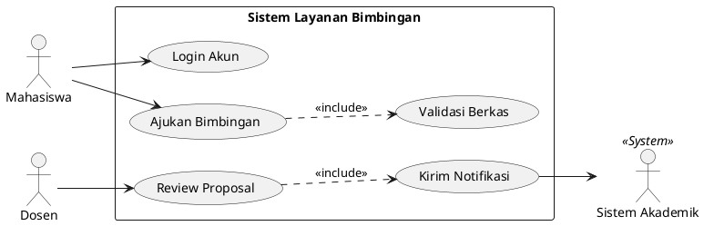
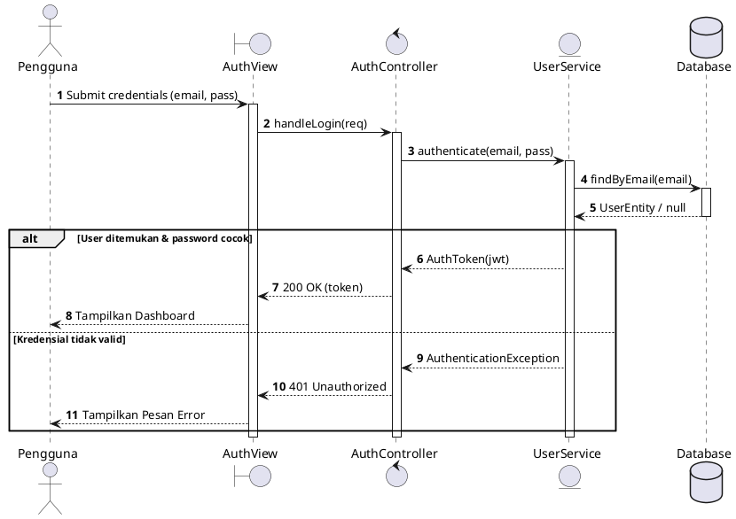
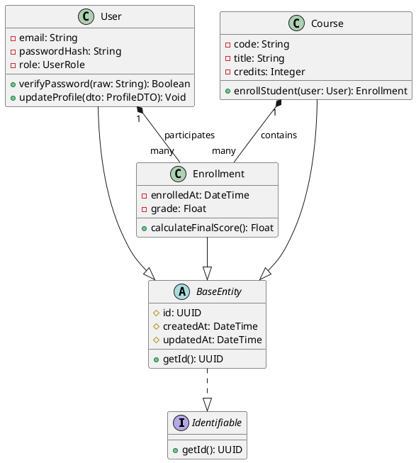
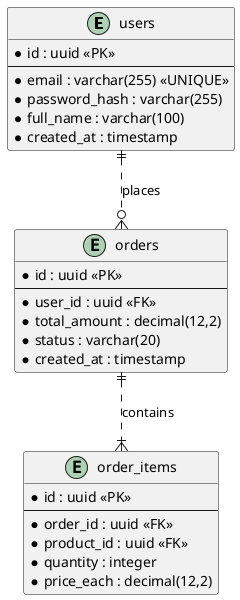
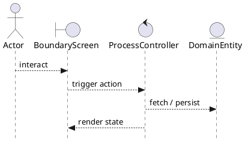

# PlantUML UML 2.5 Cheatsheet

Always start PlantUML files with `@startuml` and end with `@enduml`. Apply clean monochrome or modern themes.

## 1. Use Case Diagram

## 2. Sequence Diagram

## 3. Class Diagram (UML 2.5 Standard)

## 4. Entity Relationship Diagram (Crow's Foot)

## 5. Robustness Diagram (ICONIX BCE)

